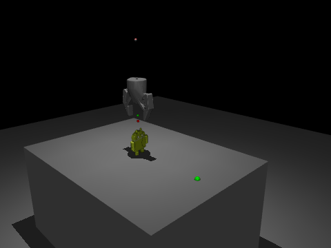

## Purpose
I created this simulation to expose myself to how simulation can help gather data for making more informed hardware decisions. An important topic of debate between hardware engineers at robotics companies is often what end effector to use for what application. To answer this without simulation there would be incredible monetary and time investment required which isn't possible for fast growing startups dialed in on moving to production quickly.

For this reason simulation is an incredibly useful tool for engineers. You can run thousands of scenarios on hundreds of object geometries in minutes without the overhead that comes with building a new test stand. I chose to run this pick-and-place simulation in MuJoCo because soft objects such as packaged sweaters and bubble wrapped items you cannot have your simulation treat the object as a rigid body. That is not how the object would behave in reality if it came into contact with an end effector thus the simulation should mimic reality as closely as possible. The phyiscs engine behind MuJuCo considers this deformation and accounts for it. Moreover, the software doesn't require any GPU to run simulation which made it viable for me as a project on a laptop without a dGPU.

## Plan
The simulation will compare two different end-effectors against many differnt objects with the goal of lifting and placing the object from point A to B along a fixed path. The fixed path ensured that the comparison was isolated to the performance of the end-effector and helped remove external influences. It's important to note that the distance the two tools went down to pick up the object was dynamic and a function of the object height itself. Without this there would be many undesireable interferences between connecting geometry of the tool and the object, which wouldn't happen for a robotic arm trained against a RL model. It's a small logic implementation that tries to control another variable. 

The simulation has the tools pick and place the same object many times given randomized starting positions. The objects would be randomized to start at different locations from the ideal center-point for the tool, rotations, have different masses and moments of inertia's. The randomizations were controlled with a "seed" variable which would allow me to replicate trials with the same object conditions. The pertabation for the object with a given seed was the same for both tools so that solely the tool performance is compared. 

## Results
Each tool picked and placed each of the 9 objects 20 times, using seeds 0 to 19, for 360 trials in total. Every trial added small random changes to the object: its start position moved up to 3 mm in x and y, it was turned up to 10°, its mass was scaled by 0.8 to 1.2 and the friction was scaled by 0.7 to 1.0. A trial only passed if the object was lifted at least 95% of the 135 mm lift, slipped less than 10 mm in the tool, turned less than 15°, and was set down within 10 mm of the target. I can easily modify these parameters to redefine what "pass" means.

Overall the fingers passed 157 of 180 trials (87%) and suction passed 101 of 180 (56%). The 95% range is the Wilson confidence interval, which is the range the true pass rate most likely falls in. It matters because 20 passes out of 20 doesn't prove the tool never fails. It only shows the pass rate is at least about 84%. Below is a summary of all the trials which were run in the simulation.

| Object | Finger (95% range) | Suction (95% range) | Most common failure |
|---|---|---|---|
| cube | 20/20 (84–100%) | 20/20 (84–100%) | none |
| flat_bottle | 20/20 (84–100%) | 20/20 (84–100%) | none |
| tall_bottle | 19/20 (76–99%) | 20/20 (84–100%) | finger: SLIP_OR_DROP (1) |
| pill_bottle | 18/20 (70–97%) | 20/20 (84–100%) | finger: INSUFFICIENT_LIFT (2) |
| candy_box | 20/20 (84–100%) | 18/20 (70–97%) | suction: CUP_LOSS_OR_DROP (2) |
| lego_figure | 20/20 (84–100%) | 3/20 (5–36%) | suction: FAILED_RELEASE (10) |
| dino_toy | 20/20 (84–100%) | 0/20 (0–16%) | suction: FAILED_RELEASE (20) |
| ink_box | 20/20 (84–100%) | 0/20 (0–16%) | suction: INSUFFICIENT_LIFT (11) |
| mug | 0/20 (0–16%) | 0/20 (0–16%) | finger: FAILED_RELEASE (11), suction: CUP_LOSS_OR_DROP (20) |

The results split the objects into three groups. On the cube, the bottles and the candy box both tools did well, and their ranges overlap so much that I can't call a winner on any of them. The fingers clearly won on the Lego figure, the dino toy and the ink box. Because both tools got the same random changes for the same seed, I could compare them trial by trial: across those three objects the fingers passed and suction failed in 57 of 60 trials, and there was no trial where suction passed and the fingers failed. That means the difference comes from the tool and not from one tool getting luckier starting conditions. On the dino toy, suction carried the object but set it down 24 to 43 mm away from the target, so it moved on the cups during the transfer. On the ink box, suction could not lift the box at all in 11 of the 20 trials.

Neither tool could handle the mug. Suction lost its grip in every trial, and the fingers either dropped it or set it down badly. Watching the simulation for the mug in the MuJuCo viewer it seems like the fingers don't open wide enough to release the mug on to the target.
### Limits
- 20 trials per object and tool, on 9 objects. That is enough to show the big differences above, but not to separate tool performance on objects that are close, like on the bottles.
- Each tool gets the object turned to suit it. For example, the lego figure is 21 mm wide between the fingers but 95 mm long under the suction cups. The random changes are added on top of that starting pose. A setup where objects arrive turned the wrong way for one tool would be a different test. The turned lego figure is demonstrated in the videos below.
  <p align="center">
    
    
  </p>
- All objects here are rigid, and the path is fixed with no robot arm, so arm error isn't included.
- Suction is modelled as two cups that each pull with a set force (10 N) while they touch the object. It does not model air leaking or the cup sealing.
- The placement check measures distance from the target, so a start offset of up to 3 mm counts against the 10 mm tolerance. I checked that this didn't change any result: suction's placement failures were all 12 mm or more off target, and the fingers' mug placement failures were within 8 mm, so the fingers failed on height instead.

### How to reproduce
```
python src/run_batch.py --n 20 --seed 0 --out results/robust.csv    # 360 trials, about 2-3 min
python src/summarize.py results/robust.csv
```
To watch any single trial again, use its seed, for example:
`python src/run_batch.py --objects dino_toy --tools suction --seed 7 --show`
